# ai-agent-attack-signatures

**Traffic signatures and detection methodology for AI-powered penetration-testing agents.**

An empirical study of 65 audited AI-pentest codebases - 64 third-party frameworks plus one
in-house implementation - determining which ones leave an attributable fingerprint on the
target side, which ones do not, and why that difference matters more than the rule count.

## The headline finding

> **Of 65 audited AI-pentest codebases (64 third-party frameworks plus one in-house
> implementation), only 10 leave a signature that can be attributed on the target side.**
>
> Most AI agents delegate the actual attack to general-purpose tooling (sqlmap, ffuf,
> nuclei, curl). From the target's point of view that traffic is indistinguishable from a
> human running the same tools. A signature catalogue that ignores this is not a
> detection capability.

This repository therefore ships **both** the signatures that hold up under real traffic
**and** an explicit, measured account of where attribution stops working.

---

## What is here

| Path | Contents |
|---|---|
| `signatures/` | The MIT-licensed subset: 444 rules (T1 194 / T2 97 / T3 153) in Elasticsearch KQL, Splunk SPL, Suricata and Sigma, plus the full metadata JSON |
| `signatures/agpl/` | The copyleft-derived subset: 166 rules from AGPL/GPL upstream frameworks (T1 78), independently deployable, AGPL-3.0-or-later |
| `docs/` | Methodology, experiment protocol, results, framework coverage matrix, limitations, threat model, **deployment guide** |
| `data/` | 15 AI-agent attack captures (211,547 requests, 12 frameworks), 6 scanner hard-negative captures (999 requests), pseudonymised feature vectors for 1,582 real attackers (103 features each), 15 aggregate tables, checksums, dataset card |
| `research/` | Reproducible pipeline and evaluation code |
| `figures/` | 12 paper-grade figures (PNG + PDF/SVG) with a caption file carrying the headline number of each |

## Quick start

```bash
# 1. deploy only T1 rules - T2 is generic attack semantics, T3 is generic tooling
#    every platform file carries a `tier` field for filtering
grep -i 'tier.*T1' signatures/ioc_rules_es.kql | head

# 2. replay your own recent traffic before going to production
#    T1 matched 0 of 9,905,794 public internet requests and 0 of 142,705
#    real WAF attack transactions - confirm the same in your environment

# 3. alert on actors, not on requests
#    decision unit = all requests from one source IP within one time window
#    on the 9.9M-request scan, exactly 1 of 80,987 source IPs matched >= 2 rules
```

## Key results

### Signature validation

| Dataset | Scale | T1 hits |
|---|---|---:|
| Public internet traffic | 9,905,794 requests / 80,987 source IPs | **0** |
| Real WAF attack transactions (ModSecurity OWASP CRS, 30 days) | 142,705 transactions | **0** |

All 16 rules that did match on public traffic are T2/T3 (generic attack payloads and
generic tooling identifiers) and are excluded from deployment.

### Behavioural detection

| Metric | Value |
|---|---|
| AI-agent actors captured (15 segments / 12 frameworks) | segment recall **13/15 = 86.7%** |
| | framework recall **10/12 = 83.3%**, one-sided 95% lower bound **0.779** (0.05^(1/12)) |
| | leave-one-framework-out recall **9/10 = 90.0%** |
| False-positive rate on real attackers (1,582 actors) | **2.72%** (95% CI [2.02%, 3.64%]) |
| False-positive rate on tool-driven scanner actors | **66.67%** (4 of 6 actors; sample is ffuf-dominated - see Limitations) |

### Rule tier composition (T1 = 272 across both licensed subsets)

| Field | Count |
|---|---:|
| Request body | 150 |
| Request path | 37 |
| **HTTP request header** | **36** |
| **User-Agent** | **35** |
| Other (TLS, proxy, credential) | 12 |
| OAST domain | 2 |

T1 covers **41 framework labels** at the source level. Only **10** were validated end-to-end as
attributable on the target side - see `docs/FRAMEWORK_COVERAGE.md` for the full matrix
and the reason for each.

---

## Limitations (please read before deploying)

1. **Attribution is not detection.** These signatures answer *which framework sent this
   request*. They do not answer *was this an AI agent*. That question is answered by the
   behavioural layer in `docs/METHODOLOGY.md`, which reaches 86.7% segment recall at a
   2.72% false-positive rate - and fails on tool-driven traffic.

2. **AI agents that delegate to generic tooling are not distinguishable.** Measured on
   six independent scanner actors: 66.67% false positives (4 of 6 flagged at threshold
   0.35), and raising the threshold does not help. This is the dominant real-world AI
   agent pattern. Note the composition of that sample: it is **ffuf-dominated** (910 of
   999 request records), with sqlmap contributing a single request and gobuster, nuclei,
   dirb and nmap contributing none. The 66.67% figure therefore characterises
   ffuf-style enumeration behaviour, not a balanced multi-tool sample.

3. **Passive HTTP detection alone is insufficient.** The reliable attribution signal for
   an AI agent is its outbound traffic to an LLM gateway. That requires egress logs.
   See `docs/LIMITATIONS.md`.

---

## Figures

| | |
|---|---|
| 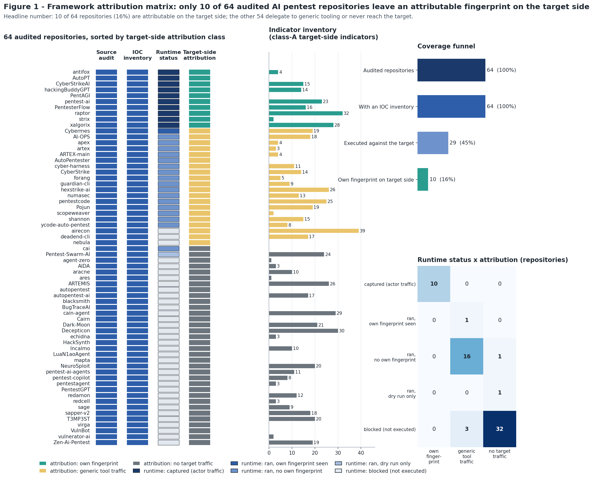 | 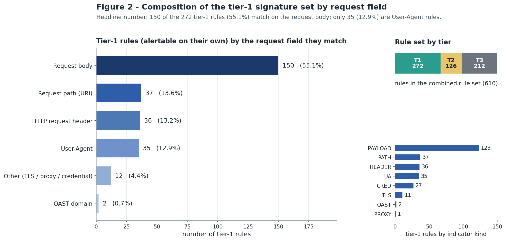 |
| **Figure 1** - framework attribution matrix: only 10 of 64 audited repositories leave an attributable fingerprint on the target side | **Figure 2** - composition of the 272 strong signatures by request field |
| 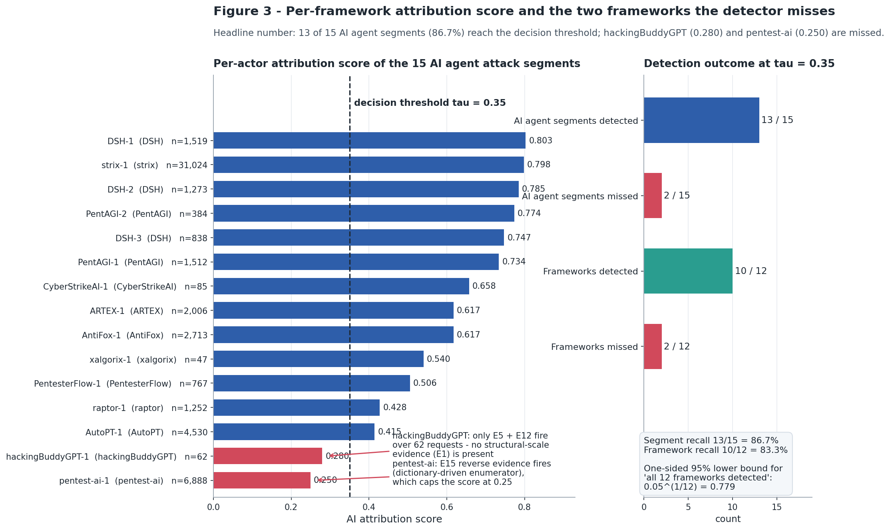 | 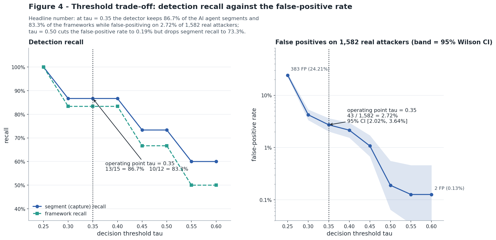 |
| **Figure 3** - AI attribution score per capture, against the decision threshold | **Figure 4** - detection recall and false-positive rate as a function of the threshold |
| 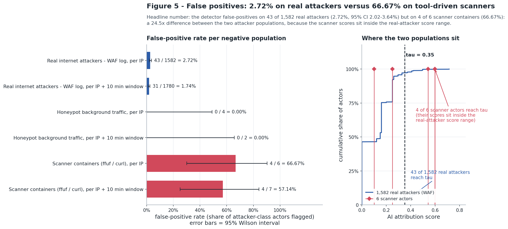 | 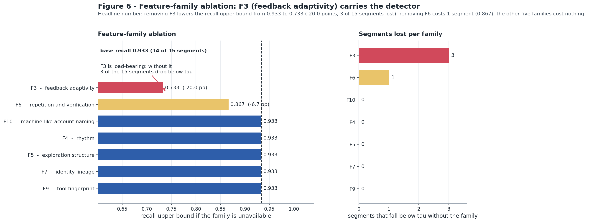 |
| **Figure 5** - false positives on real attackers versus tool-driven scanners | **Figure 6** - recall ceiling when each feature family is removed |
| 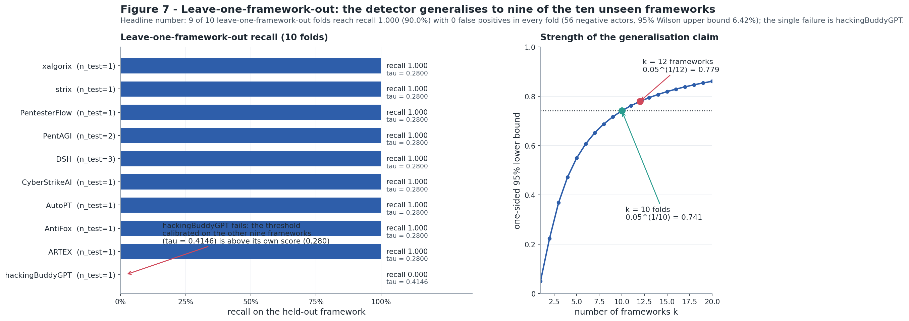 | 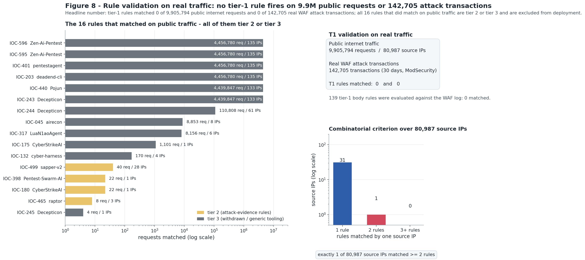 |
| **Figure 7** - leave-one-framework-out recall per held-out framework | **Figure 8** - rule validation on 9.9M real requests |
| 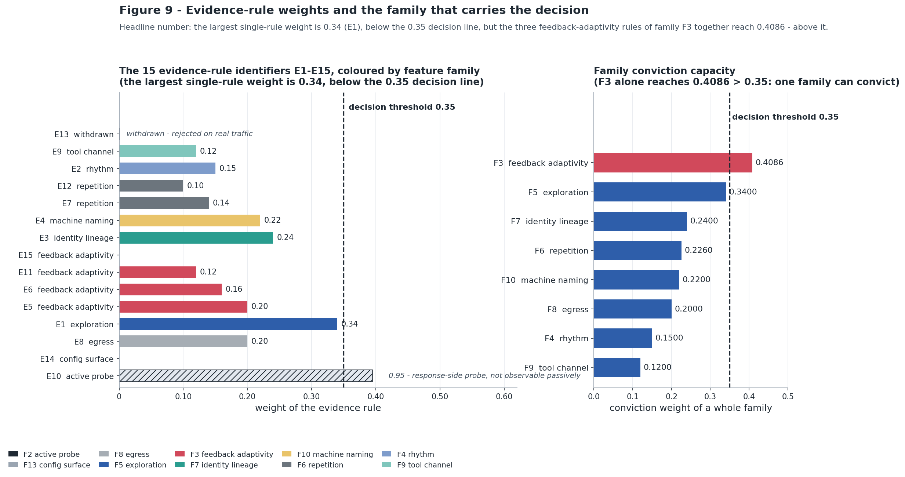 | 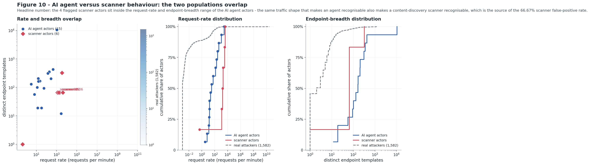 |
| **Figure 9** - evidence-rule weights grouped by feature family | **Figure 10** - why agent traffic and scanner traffic overlap |
| 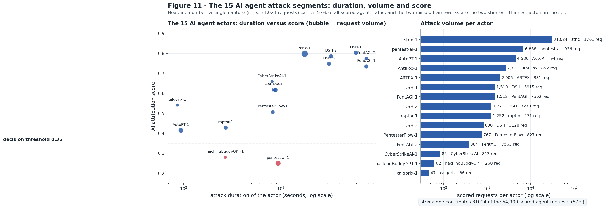 | 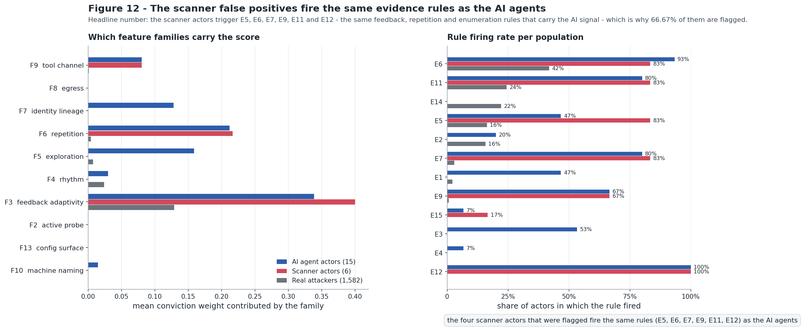 |
| **Figure 11** - request volume over time per agent capture | **Figure 12** - which evidence rules separate agents, scanners and real attackers |

Full captions: `figures/CAPTIONS.md`. Vector versions (PDF/SVG) are in `figures/vector/`.

---


## Reproducing the results

```bash
cd research
pip install -r requirements.txt
python pipeline/score_actor.py --input ../data/positive --out ../out/actor
python evaluation/evaluate_detection.py --actors ../out/actor --out ../out/metrics.json
python evaluation/false_positive_eval.py --features ../data/features --out ../out/fp.json
```

Every number in this README is asserted by CI against the shipped data.

**Scope of reproducibility.** Re-scoring the published captures reproduces the recorded
score exactly for 10 of the 15 positive captures. For the other five, the published file is
the complete pseudonymised capture whereas the recorded score was computed on the
agent-labelled subset of the original capture, so a full re-score yields a different (and
not directly comparable) value. The published numbers therefore come from
`data/aggregate/framework_detection.json`, and the pipeline demonstrates that the
*computation* is reproducible. See `research/README.md`.

---

## Deployment

Full instructions per platform - loading the rules, replaying your own traffic before
production, choosing a threshold, and correlating with egress traffic - are in
**[`docs/DEPLOY.md`](docs/DEPLOY.md)**.

```bash
# 1. replay your own traffic before production - expect zero hits on T1
# 2. deploy only the T1 rules
# 3. alert on actors (one source address within a time window), never on single requests
# 4. alert when an actor matches two or more distinct rules
```

## Contributing

**Framework authors: please submit your own signatures.**

A signature set rots fast - one UA change and a rule dies. We audit by downloading
repositories and reading source, which takes days per refresh. If you maintain one of the
frameworks covered here, you know your own markers better than we do.

- open an issue using the `new-framework-signature` template, or
- open a pull request adding your signature to `signatures/rules.json`, or
- tell us a signature no longer matches so we can retire it.

You can also ask us to **remove** a signature for your framework; we will honour that.
See `CONTRIBUTING.md`.

## Project documents

| Document | What it is for |
|---|---|
| [`docs/PAPER.md`](docs/PAPER.md) | The full paper |
| [`docs/DEPLOY.md`](docs/DEPLOY.md) | How to load and validate the rules in production |
| [`docs/METHODOLOGY.md`](docs/METHODOLOGY.md) | The detector: decision unit, features, evidence rules, algebra |
| [`docs/EXPERIMENTS.md`](docs/EXPERIMENTS.md) | The experimental protocol |
| [`docs/RESULTS.md`](docs/RESULTS.md) | Every measured number |
| [`docs/FRAMEWORK_COVERAGE.md`](docs/FRAMEWORK_COVERAGE.md) | Per-framework attribution matrix |
| [`docs/LIMITATIONS.md`](docs/LIMITATIONS.md) | Where attribution provably fails |
| [`docs/THREAT_MODEL.md`](docs/THREAT_MODEL.md) | Offensive risk of publishing this, and the maintenance model |
| [`ROADMAP.md`](ROADMAP.md) | What is being worked on next |
| [`CHANGELOG.md`](CHANGELOG.md) | Release history |
| [`data/DATASET_CARD.md`](data/DATASET_CARD.md) | Dataset provenance, licensing and limitations |

## Citation

See `CITATION.cff`. If you use the signatures or the methodology in published work,
please cite the repository and the paper referenced there.

## License

The repository is MIT licensed (`LICENSE`). Signatures derived from copyleft-licensed
upstream frameworks are isolated under `signatures/agpl/` and carry their own
AGPL-3.0 / GPL / LGPL terms - see `NOTICE`.

Third-party framework names and identifiers are the property of their respective authors
and are used for research attribution.
